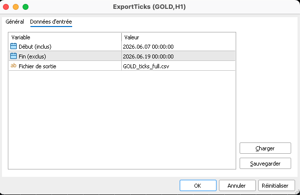
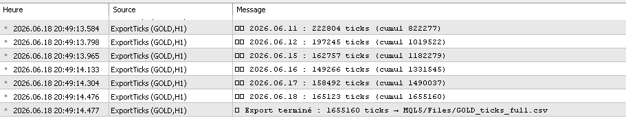
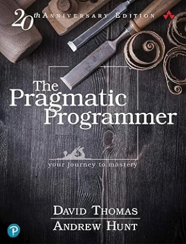

# ExportTicks — Export complet des ticks MetaTrader 5 vers CSV

<p align="center">🇺🇸 <a href="README.md">English</a> · 🇫🇷 <b>Français</b></p>

Script **MQL5** pour MetaTrader 5 qui exporte **l'intégralité des ticks** d'un symbole
sur une période donnée dans un fichier CSV, pour analyse hors-ligne (Python, Excel, etc.).

Il **contourne la limite de 131 072 ticks** du visualiseur intégré de MT5 en utilisant
`CopyTicksRange()` **jour par jour**, ce qui le rend robuste en mémoire et sans plafond :
des millions de ticks peuvent être exportés en un seul passage.



## Pourquoi ce script ?

Le visualiseur de ticks de MT5 plafonne l'affichage et l'export à 131 072 ticks, ce qui
est insuffisant pour analyser plusieurs jours de données haute fréquence (le GOLD génère
facilement > 150 000 ticks par jour). En découpant la requête par tranches de 24 h et en
écrivant au fil de l'eau, `ExportTicks` lève cette contrainte.

## Format de sortie

Fichier texte tabulé (`\t`), une ligne d'en-tête puis une ligne par tick :

```
<DATE>	<TIME>	<BID>	<ASK>
2026.06.11	00:00:01.482	2310.45	2310.78
...
```

- `<DATE>` : `AAAA.MM.JJ`
- `<TIME>` : `HH:MM:SS.mmm` (millisecondes incluses)
- `<BID>` / `<ASK>` : cours arrondis au nombre de décimales du symbole (`_Digits`)

Ce format est directement exploitable par des scripts d'analyse (à l'origine compatible
avec un `replay_ai_decisions.py`).

## Installation

1. Copier `ExportTicks.mq5` dans le dossier `MQL5/Scripts` de ton terminal MT5
   (*Fichier → Ouvrir le dossier de données*).
2. Dans MetaEditor, ouvrir le fichier et compiler avec **F7**.
3. Le script apparaît dans le **Navigateur → Scripts** de MT5.

## Utilisation

1. Ouvrir un graphique du symbole voulu (ex. `GOLD`, n'importe quelle période — H1 suffit).
2. Glisser-déposer le script sur le graphique.
3. Renseigner les paramètres d'entrée :

| Paramètre | Description | Exemple |
| --- | --- | --- |
| `InpFrom` | Date/heure de début (**inclus**) | `2026.06.07 00:00:00` |
| `InpTo` | Date/heure de fin (**exclus**) | `2026.06.19 00:00:00` |
| `InpFileName` | Nom du fichier CSV de sortie | `GOLD_ticks_full.csv` |

4. Valider. La progression s'affiche dans l'onglet **Experts / Journal** :



Le fichier est écrit dans `MQL5/Files/` du dossier de données du terminal
(*Fichier → Ouvrir le dossier de données → MQL5 → Files*).

> 💡 Les ticks ne sont disponibles que si MT5 les a téléchargés au préalable.
> Pour une période ancienne, ouvre d'abord le symbole et laisse l'historique des
> ticks se charger (clic sur le graphique + défilement), sinon certaines journées
> reviendront vides.

## Notes techniques

- Découpage **jour par jour** (`86400 s`) : empêche les pics mémoire et supprime tout
  plafond sur le volume total.
- `CopyTicksRange(_Symbol, ..., COPY_TICKS_ALL, from_msc, to_msc)` borné à la milliseconde.
- Écriture en `FILE_TXT | FILE_ANSI` avec fins de ligne `\r\n` (compatible Windows/Excel).

## Licence

[MIT](LICENSE) — koua29.

---

## 📚 À lire

*Liens partenaires Amazon : si vous achetez via ces liens, le projet touche une petite commission, sans surcoût pour vous.*

<table>
<tr>
<td align="center" width="33%">
  <a href="https://www.amazon.fr/dp/1394159161?linkCode=ll2&amp;tag=koua29mt5-21&amp;ref_=as_li_ss_tl"></a><br>
  <b><a href="https://www.amazon.fr/dp/1394159161?linkCode=ll2&amp;tag=koua29mt5-21&amp;ref_=as_li_ss_tl">GitHub For Dummies (en anglais)</a></b><br><sub>Le contrôle de version et les pull requests, pas à pas</sub>
</td>
<td align="center" width="33%">
  <a href="https://www.amazon.fr/dp/0135957052?linkCode=ll2&amp;tag=koua29mt5-21&amp;ref_=as_li_ss_tl"></a><br>
  <b><a href="https://www.amazon.fr/dp/0135957052?linkCode=ll2&amp;tag=koua29mt5-21&amp;ref_=as_li_ss_tl">The Pragmatic Programmer (en anglais)</a></b><br><sub>Le classique du métier, 20 ans après</sub>
</td>
<td align="center" width="33%">
  <a href="https://www.amazon.fr/dp/B0F6S5425Y?linkCode=ll2&amp;tag=koua29mt5-21&amp;ref_=as_li_ss_tl"></a><br>
  <b><a href="https://www.amazon.fr/dp/B0F6S5425Y?linkCode=ll2&amp;tag=koua29mt5-21&amp;ref_=as_li_ss_tl">Beyond Vibe Coding (en anglais)</a></b><br><sub>Du codeur au développeur de l'ère IA</sub>
</td>
</tr>
</table>

<sub>En tant que Partenaire Amazon, je réalise un bénéfice sur les achats remplissant les conditions requises.</sub>
