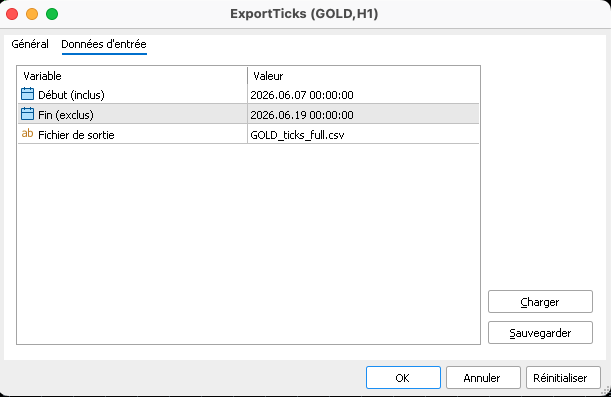
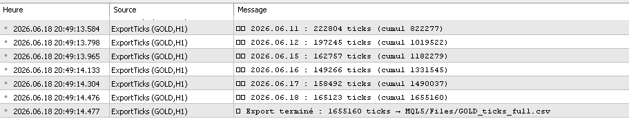

# ExportTicks — Full MetaTrader 5 tick export to CSV

<p align="center">🇺🇸 <b>English</b> · 🇫🇷 <a href="README.fr.md">Français</a></p>

An **MQL5** script for MetaTrader 5 that exports **every single tick** of a symbol
over a given period to a CSV file, for offline analysis (Python, Excel, etc.).

It **gets around the 131,072-tick limit** of MT5's built-in viewer by calling
`CopyTicksRange()` **one day at a time**, which keeps memory use low and removes any cap:
millions of ticks can be exported in a single run.



## Why this script?

MT5's tick viewer caps display and export at 131,072 ticks, which is not enough
to analyse several days of high-frequency data (GOLD easily produces
> 150,000 ticks a day). By splitting the request into 24-hour slices and
writing as it goes, `ExportTicks` lifts that limit.

## Output format

Tab-separated text file (`\t`), one header line then one line per tick:

```
<DATE>	<TIME>	<BID>	<ASK>
2026.06.11	00:00:01.482	2310.45	2310.78
...
```

- `<DATE>`: `YYYY.MM.DD`
- `<TIME>`: `HH:MM:SS.mmm` (milliseconds included)
- `<BID>` / `<ASK>`: prices rounded to the symbol's number of decimals (`_Digits`)

This format can be used directly by analysis scripts (originally compatible
with a `replay_ai_decisions.py`).

## Installation

1. Copy `ExportTicks.mq5` into the `MQL5/Scripts` folder of your MT5 terminal
   (*File → Open Data Folder*).
2. In MetaEditor, open the file and compile it with **F7**.
3. The script shows up in MT5's **Navigator → Scripts**.

## Usage

1. Open a chart of the symbol you want (e.g. `GOLD`, any timeframe — H1 is fine).
2. Drag and drop the script onto the chart.
3. Fill in the input parameters:

| Parameter | Description | Example |
| --- | --- | --- |
| `InpFrom` | Start date/time (**inclusive**) | `2026.06.07 00:00:00` |
| `InpTo` | End date/time (**exclusive**) | `2026.06.19 00:00:00` |
| `InpFileName` | Output CSV file name | `GOLD_ticks_full.csv` |

4. Confirm. Progress is shown in the **Experts / Journal** tab:



The file is written to `MQL5/Files/` in the terminal's data folder
(*File → Open Data Folder → MQL5 → Files*).

> 💡 Ticks are only available if MT5 has downloaded them beforehand.
> For an older period, open the symbol first and let the tick history
> load (click the chart + scroll back), otherwise some days
> will come back empty.

## Technical notes

- **Day-by-day** slicing (`86400 s`): avoids memory spikes and removes any
  cap on the total volume.
- `CopyTicksRange(_Symbol, ..., COPY_TICKS_ALL, from_msc, to_msc)` bounded to the millisecond.
- Written as `FILE_TXT | FILE_ANSI` with `\r\n` line endings (Windows/Excel friendly).

## License

[MIT](LICENSE) — koua29.
